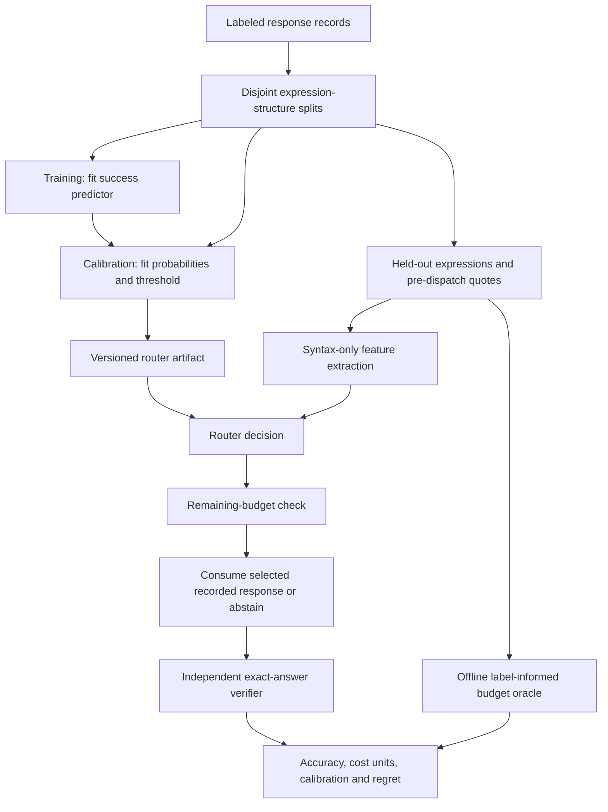
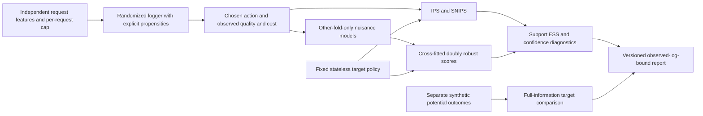

# Routing data and decision boundaries

## Contract

A record contains one bounded arithmetic expression and exactly two candidate response records, `small` and `large`. Expressions use integer constants, unary minus, addition, subtraction and multiplication. There is no Python `eval`, arbitrary code, variable access, division, exponentiation, or filesystem/network execution. Inputs are bounded to 256 expression characters, 16 AST levels, integer leaves of magnitude 10,000, and labeled results of magnitude 10^12. Corpora are bounded to 20,000 records.

Response costs are positive integer units, at most 100,000 each. Batch budgets are nonnegative integer units, at most 100,000. A selected response is consumed only after a budget check. No affordable response means abstention. The CLI replays data; a future live executor must keep this gate before its provider call.

## Data isolation

The synthetic generator creates 60 distinct binary expression structures and assigns each entire structure to a split before generating its three numeric variants. Validation checks unique case IDs, explicit template groups, and canonical AST shapes across splits. Literal spelling, redundant parentheses and whitespace cannot disguise the same AST. This is syntactic structural isolation, not a proof of semantic independence under algebraic identities. Feature extraction validates syntax but does not invoke the exact-answer oracle. Training labels come only from training responses. Platt calibration and threshold selection use only calibration responses. Test labels are consumed solely by scoring and the offline oracle.

Schema-2 training artifacts contain coefficient values, threshold, dataset hashes, exact training/calibration template ID sets, and the budget used for threshold selection. Schema-1 artifacts are rejected with an explicit retraining instruction. Those IDs are checked against evaluation templates, and training/calibration hashes must match the supplied splits. Renaming groups and swapping previously trained rows into test therefore fails validation. Imported metadata cannot prove the provenance of someone else's training run; use the included training command to reproduce it.

## Model and calibration

The pure-Python logistic learner uses a bias and five scaled syntax features, batch gradient descent, and L2 regularization on non-bias weights. A second logistic fit maps raw logits to calibrated small-model-success probabilities. Candidate thresholds are selected by maximum calibration correct count, then lower spend. There is no promise that calibration helps every dataset; held-out Brier/ECE values make failures observable.

## Baselines and oracle

Fixed-small and fixed-large always select that candidate if affordable. The heuristic uses operation count. Learned routing selects from the calibrated probability and falls back if only the other candidate fits. All policies receive the same record ordering and budget. Different fallback behavior is explicitly visible in the policy definition.

The exact upper bound exploits the unit-value objective. A wrong response is dominated by free abstention, and a more expensive correct response for the same case is dominated by its cheapest correct response. Sorting those cheapest correct costs and taking an affordable prefix therefore maximizes correct case count exactly in O(n log n), independently of the numeric budget. The report exports the selected offline plan and spend. Exhaustive enumeration on tiny cases checks both maximum correct count and minimum spend for that count. The router never sees this oracle or candidate outcomes before choosing.

## Provenance and reporting

Default responses are generated by seeded success/failure simulation. Their costs are artificial integer units and latency is unknown. Reports preserve `SIMULATED`/`RECORDED`, source model identities, split denominators and dataset hashes. Recorded inputs require model identity and timestamp; this metadata is supplied by the collector, not independently attested. Answer scoring accepts bounded integer or rational strings with at most fourteen digits per component; explanatory prose and scientific notation are incorrect rather than expanded into unbounded integers. Raw prompts and outputs remain local files; do not import secrets or personal data into a public benchmark.

## Complexity

Training is linear in examples × features × epochs. The unit-value exact oracle uses O(n log n) time and O(n) memory. If cases later receive unequal reward weights or cross-case dependencies, this greedy proof no longer applies and the algorithm must be replaced. Offline reports contain every routing decision so results can be inspected.

## Sensitivity and calibration diagnostics

The optional `sweep` experiment freezes one calibrated router trained at its declared reference budget. Each supplied test budget is evaluated under the original ordering and deterministic shuffles; no test-derived threshold is selected. Reports retain every ordering's correct count, spend and oracle regret, plus minimum/mean/maximum counts. This reveals order effects and budget transfer failures rather than presenting one favorable batch as universal performance.

Test calibration reports include raw versus calibrated Brier/ECE/log-loss diagnostics. The calibration split is reused for Platt fitting and threshold selection, which can overfit that split; the untouched test split is the quality check, not another fitting stage. An artifact evaluated under a different per-case budget reports that mismatch explicitly.

Only fully RECORDED test candidate sets set `model_evaluation=true`. Mixed datasets are explicitly labeled and each policy counts provenance for responses it actually consumed. Training-only recorded metadata cannot upgrade simulated test measurements. Collectors still supply those metadata claims; the replay system does not attest their truth.

JSONL input uses bounded `readline` calls before decoding, with line, total-character and record caps. Artifact reads are bounded before JSON parsing. Duplicate fields, non-finite JSON numbers, malformed model metadata and non-finite training features fail validation at the boundary. All original and review examples remain local synthetic data.

## Separate stateless off-policy subsystem

This layer has no batch remaining-budget state. It rejects support violations rather than returning model-only guesses, and respects admission caps before any action probability is assigned. Potential outcomes are visible only to the synthetic comparison path. `estimators-and-routing.md` specifies identification and interval assumptions; `bandit-evaluation-record.md` records actual runs. The existing sequential routing interfaces remain unchanged.
